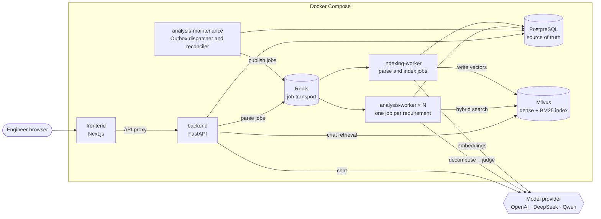
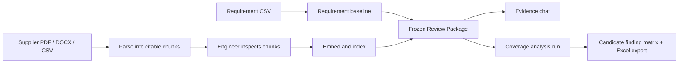
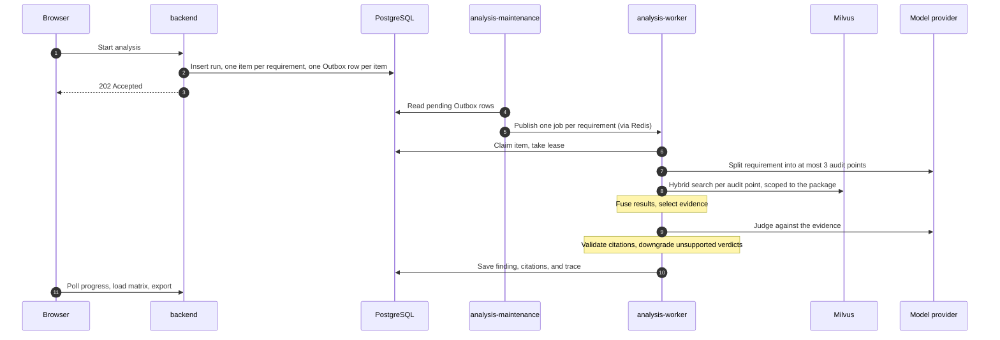

# Warehouse Automation Design Review Assistant

A local, evidence-grounded RAG workspace for reviewing warehouse-automation supplier design documents against controlled requirements.

An engineer imports a URS/ES requirement table, registers a supplier Functional, Software Design, or Hardware Design Specification, freezes both into a **Review Package**, and then either asks questions against that scope or generates a requirement-by-requirement **candidate finding matrix** in which every conclusion carries citations to a document version, section, and page.

It is an engineering support tool. It does **not** approve, reject, release, or certify a design, supplier, or GxP decision. Outputs are candidate findings for an engineer to review.

## What it does

| Workspace view        | Purpose                                                                                                                                                           |
| --------------------- | ----------------------------------------------------------------------------------------------------------------------------------------------------------------- |
| **Knowledge control** | Import a requirement baseline (CSV). Register, parse, inspect, and index supplier documents (PDF, DOCX, CSV).                                                     |
| **Review packages**   | Freeze one requirement baseline and one indexed supplier document version into an immutable review scope.                                                         |
| **Evidence chat**     | Ask questions in Chinese or English against a frozen scope. Answers are in English, with citations that open the original PDF page.                               |
| **Review matrix**     | Run an asynchronous coverage analysis over every frozen requirement, watch per-requirement progress, retry failures, and export the traceability matrix to Excel. |

There is no open-web search and no autonomous agent loop: every answer comes from the selected document versions.

## Architecture



| Service                | Role                                                                                                                                  |
| ---------------------- | ------------------------------------------------------------------------------------------------------------------------------------- |
| `frontend`             | Next.js workspace. Proxies every API call, so the browser never talks to the backend directly.                                        |
| `backend`              | FastAPI. Authentication, metadata, upload staging, chat, progress, and export. It never parses, embeds, or analyses inside a request. |
| `indexing-worker`      | Parses uploaded documents and builds the retrieval index.                                                                             |
| `analysis-worker`      | Evaluates one frozen requirement per job. Scale it for concurrency.                                                                   |
| `analysis-maintenance` | Publishes queued work to Redis and repairs orphaned parse, index, and analysis jobs.                                                  |

Three stores, three roles:

- **PostgreSQL** is the source of truth: documents, parsed chunks, requirements, Review Packages, runs, findings, and citations.
- **Milvus** holds vectors and keyword indexes only. It can be rebuilt from PostgreSQL.
- **Redis** only transports jobs. The database decides what must run, so work survives a Redis outage or a crashed worker.

## Data flow



1. **Import requirements.** A CSV becomes structured requirements with stable codes such as `URS-001`.
2. **Ingest a document.** Upload stages the file and queues a parse job. The worker produces citable chunks: text passages and individual table rows, each with page and section.
3. **Inspect, then index.** Indexing is a separate step, so extraction can be reviewed before a document becomes searchable.
4. **Freeze a Review Package.** Requirements are copied into the package and the document version becomes immutable. Later edits cannot change what a review was assessed against.
5. **Chat or analyse.** Both retrieve only inside the frozen scope.

A coverage analysis run, end to end:



Each requirement is an independent job: one failure never blocks the rest, and failed items can be retried without rerunning completed ones.

## Run locally

Prerequisites: Docker Desktop and an API key for a supported model provider.

```powershell
Copy-Item .env.example .env
```

Set `OPENAI_API_KEY` and a unique `AUTH_SECRET` in `.env`, then:

```powershell
docker compose up --build --scale analysis-worker=2
```

Open http://localhost:3000.

To bootstrap an administrator, set `DDIT_ADMIN_EMAIL` / `DDIT_ADMIN_PASSWORD` or `QA_ADMIN_EMAIL` / `QA_ADMIN_PASSWORD`. Only administrators can import baselines and register, parse, or index documents. All settings are documented in [.env.example](.env.example).

A requirement CSV looks like this:

```csv
no,system,requirement,rationale/impact,critical,priority,category
1,Fleet Manager,The system shall prevent dispatch to unavailable AGVs.,Operational continuity,Yes,Critical,Dispatch
```

## Testing

```powershell
uv run pytest
```

Tests use an in-memory queue and fake model adapters, so they need no external services.

## Further reading

| Document                                           | Covers                                                                               |
| -------------------------------------------------- | ------------------------------------------------------------------------------------ |
| [app/README.md](app/README.md)                     | Backend code structure, data model, API surface, configuration                       |
| [app/services/README.md](app/services/README.md)   | Parsing, indexing, hybrid retrieval, analysis strategies, judgement guardrails, chat |
| [app/workers/README.md](app/workers/README.md)     | Queues, the Outbox, leases, and failure recovery                                     |
| [frontend-next/README.md](frontend-next/README.md) | Workspace views, API proxy, local frontend development                               |
