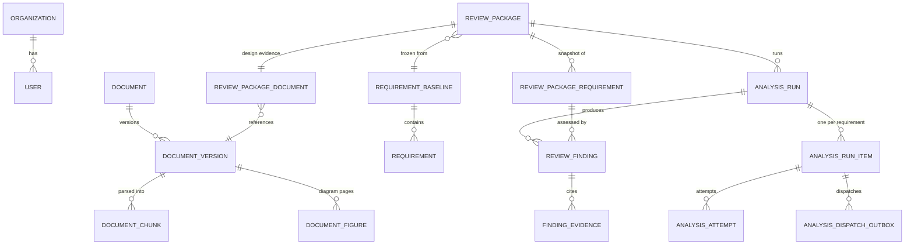

# Backend

FastAPI application, background workers, and the business rules of the design-review workflow. For the system overview, see the [root README](../README.md).

## Code structure

```text
app/
├── main.py         FastAPI app, startup validation, admin bootstrap
├── api/            Routes, request/response schemas, auth dependencies
├── bootstrap/      service_factory.py: the only place concrete adapters are assembled
├── core/           Settings, logging, code-backed bilingual glossary
├── domain/         ORM models, enums, evidence contracts, ports (Protocols)
├── repositories/   database.py (SQLAlchemy), milvus_repository.py (the only Milvus-aware module)
├── services/       Ingestion, indexing, retrieval, coverage analysis, chat, export
└── workers/        RQ entry points and the maintenance loop
```

HTTP, business rules, and infrastructure are kept apart. Services depend on `Protocol` interfaces (`RetrievalService`, `EmbeddingService`, `FindingJudge`, `DocumentChunkIndex`, and the queue protocols), so the model provider, the vector store, and the queue are each replaceable by an adapter, and tests run with in-memory fakes.

- [services/README.md](services/README.md): parsing, indexing, retrieval, analysis, chat
- [workers/README.md](workers/README.md): queues and failure recovery

## Data model



Two design points:

- **A Review Package is a snapshot.** Requirements are copied into `review_package_requirements`, and the linked document version can no longer be re-uploaded or reparsed. A package accepts exactly one supplier version, of type FS, SDS, or HDS, that is indexed, not archived, and in the same system as the baseline.
- **Citations are frozen copies.** `finding_evidence` stores the chunk ID, title, version, page, section, and excerpt rather than a foreign key, so a finding stays readable exactly as it was assessed.

Tables are created at startup with `create_all` plus a few additive column checks. There is no migration tool yet.

## API surface

Interactive documentation is served at `/docs`. All routes except `/`, `/auth/config`, `/auth/register`, and `/auth/login` require a bearer token; routes marked *admin* require the administrator role.

| Area | Endpoints |
|---|---|
| Auth | `GET /auth/config` · `POST /auth/register` · `POST /auth/login` · `GET /auth/me` |
| Requirements | `POST /requirement-baselines/import` *(admin)* · `GET /requirement-baselines` · `GET /requirement-baselines/{id}/requirements` |
| Documents | `POST /documents` *(admin)* · `GET /documents` · `POST /documents/{id}/upload` *(admin)* · `POST /documents/{id}/reparse` *(admin)* · `POST /documents/{id}/index` *(admin)* · `POST /documents/{id}/archive` *(admin)* |
| Document reading | `GET /documents/{id}/chunks` · `GET /documents/{id}/chunks/{chunk_id}/context` · `GET /documents/{id}/source` · `GET /documents/{id}/figures` |
| Review packages | `POST /review-packages` · `GET /review-packages` · `GET /review-packages/{id}` |
| Analysis | `POST /review-packages/{id}/analyses` · `GET /review-packages/{id}/analyses` · `GET /analysis-runs/{id}` · `POST /analysis-runs/{id}/retry` |
| Results | `GET /analysis-runs/{id}/progress` · `GET /analysis-runs/{id}/events` (SSE) · `GET /analysis-runs/{id}/findings` · `GET /analysis-runs/{id}/matrix` · `GET /analysis-runs/{id}/export.xlsx` |
| Chat | `POST /design-review/chat` · `POST /design-review/chat/stream` · `POST /document-chat` |

Authentication is local email and password: scrypt password hashes and HS256 JWT sessions. Users belong to one of two fixed departments, `DDIT` or `QA`, and Review Packages are visible only to their owner within that department.

## Configuration

Settings are environment variables defined in `core/config.py`. [.env.example](../.env.example) lists every one with comments. The ones that change behaviour rather than wiring:

| Variable | Default | Purpose |
|---|---|---|
| `LLM_PROVIDER` / `CHAT_MODEL` | `openai` / `gpt-4o` | Chat, decomposition, and judging. `deepseek` and `qwen` are also supported. |
| `EMBEDDING_PROVIDER` / `EMBEDDING_MODEL` / `EMBEDDING_DIMENSIONS` | `openai` / `text-embedding-3-small` / `1536` | Chosen independently of the chat provider, so chat models can be compared on one frozen index. Changing these requires re-indexing. |
| `EMBEDDING_BATCH_TOKEN_BUDGET` / `EMBEDDING_TOKENS_PER_MINUTE` | `10000` / `30000` | Indexing throughput. |
| `REVIEW_EVIDENCE_SELECTION_POLICY` | `source_table_groups_v1` | Evidence selection for new runs. `ranked_chunks_v1` restores the plain top 10. |
| `ANALYSIS_ITEM_MAX_ATTEMPTS` / `ANALYSIS_RETRY_DELAYS_SECONDS` | `3` / `[2,5]` | Per-requirement retry budget. |
| `ANALYSIS_LEASE_SECONDS` / `ANALYSIS_HEARTBEAT_INTERVAL_SECONDS` | `360` / `30` | Worker lease and renewal interval. |
| `DOCUMENT_INDEX_MAX_ATTEMPTS` / `DOCUMENT_PARSE_STALE_AFTER_SECONDS` | `3` / `3600` | Indexing retry budget and the deadline for a lost parse job. |
| `MAX_UPLOAD_SIZE_MB` | `50` | Upload limit enforced by the API. |
| `ENABLE_VISUAL_ANALYSIS` | `false` | Opt-in vision-model interpretation of diagram pages. |

`AUTH_SECRET` is required: the application refuses to start with a missing or placeholder value. Docker Compose injects `DATABASE_URL`, `MILVUS_URI`, and `REDIS_URL`; outside Compose, `DATABASE_URL` defaults to a local SQLite file, which the test suite uses.

## Running without Docker

Start PostgreSQL, Milvus, and Redis with Compose, then run the API on the host:

```powershell
uv run uvicorn app.main:app --reload
```

PostgreSQL and Redis are published on non-standard host ports (see `docker-compose.yml`), so point `DATABASE_URL` and `REDIS_URL` at those.
