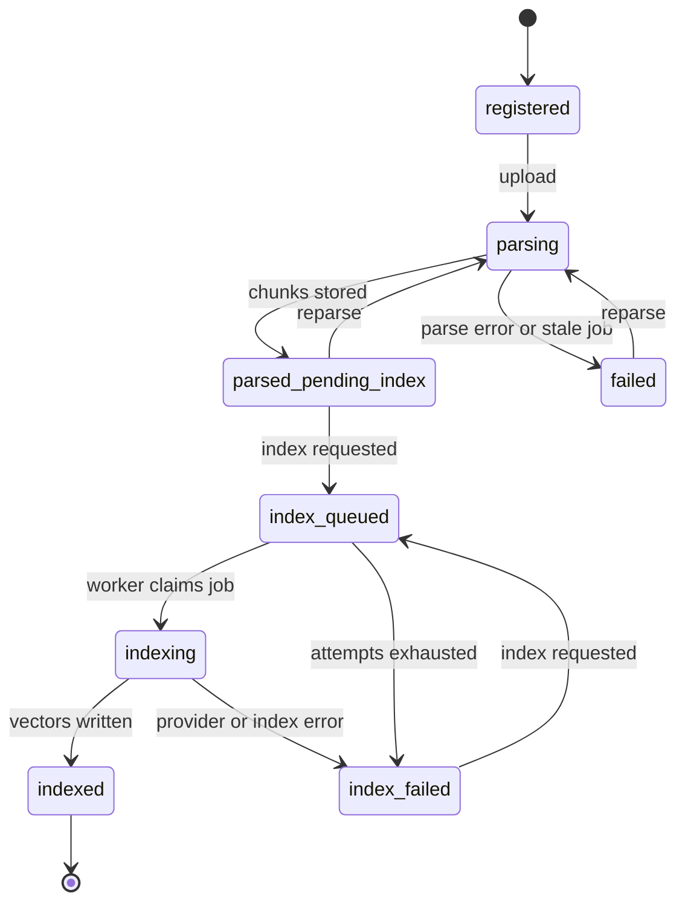

# Services

The business logic of the review workflow: turning documents into citable chunks, retrieving evidence inside a frozen scope, and producing candidate findings.

| Module | Responsibility |
|---|---|
| `ingestion_service.py` | Stage uploads, parse PDF / DOCX / CSV into chunks |
| `indexing_service.py` | Embed chunks and write them to the vector index |
| `retrieval_service.py` | Scoped hybrid retrieval, the only entry point to the index |
| `coverage_service.py` | Audit-point decomposition, evidence fusion, judgement, guardrails |
| `evidence_selection.py` | Group, deduplicate, and budget evidence for the judge |
| `design_review_chat_service.py` | Query normalisation and grounded answers |
| `review_service.py` | Baselines, Review Packages, analysis-run creation |
| `matrix_export_service.py` | Excel traceability matrix |
| `trace_capture.py` | Per-attempt audit trace |
| `*_queue.py`, `*_reliability_service.py` | Job dispatch and recovery, see [workers/README.md](../workers/README.md) |

## Document ingestion and indexing

Parsing and indexing are separate, operator-triggered steps.

**Upload.** The API writes the file under `data/raw/`, records its SHA-256, sets the status to `parsing`, and queues a parse job. If the queue cannot accept the job, the version is marked `failed` rather than left stuck.

**Parse.**

| Source | Behaviour |
|---|---|
| PDF | PyMuPDF. Text is split with heading awareness into passages of about 2,200 characters with 200 characters of overlap. Tables are detected separately and emitted as one chunk per logical row, with headers kept in metadata and repeated headers on continuation pages normalised away. Repeated page header/footer lines are removed. A page with no embedded text yields a diagnostic chunk flagging that OCR is required. Encrypted PDFs are opened with a password that is never stored. |
| DOCX | Headings, paragraphs, and individual table rows are preserved as structural chunks. |
| CSV | Each data row becomes a chunk. |

Every chunk records its page, section path, a deterministic parent-section ID, its element type, and, for table rows, a table ID and header list. Pages that likely contain diagrams are rendered and kept for human review.

**Index.** Each chunk is embedded with its section path and, for table rows, the table header prepended; the stored citable content stays untouched. Embedding runs in token-budgeted batches under a tokens-per-minute limit, with backoff on rate-limit errors. The worker then replaces all of the version's rows in the index in one operation.

## Hybrid retrieval

`HybridRetrievalService` embeds the query and issues two searches inside Milvus, fused with Reciprocal Rank Fusion:

| Branch | Metric |
|---|---|
| Dense vector | Cosine |
| Sparse vector, from a BM25 function over the chunk content | BM25 |

Both branches carry the same filter: document version IDs, system, and document type. Retrieval refuses to run without at least one document version, so a query cannot leak outside the selected scope.

## Coverage analysis

### Strategies

| Strategy | Queries | Per-query limit |
|---|---|---|
| `original` | The requirement text, unchanged | 10 |
| `decomposed` (default) | One per audit point: requirement code plus the audit point | 6 |

For `decomposed`, the model splits a requirement into one to three audit points. Each must quote an exact, contiguous excerpt of the original requirement; points whose excerpt is not found in the source are dropped, and if none survive the requirement is assessed as a single point. The ranked lists are merged with a second, cross-query RRF layer, which combines ranks rather than comparing scores across independent queries.

### Evidence selection

The policy is frozen into each run when it is created.

| Policy | Behaviour |
|---|---|
| `source_table_groups_v1` (default) | Retrieves a wider candidate pool, groups rows from the same source table so they reach the judge together, removes exact duplicates, keeps a numbered procedure's next-page continuation, and compacts repeated table headers. Limited to 10 groups and 24,000 context characters; anything deferred is recorded in the trace. |
| `ranked_chunks_v1` | The plain top-10 ranked chunks. |

### Judgement and guardrails

The judge returns a structured verdict with one of six statuses:

| Status | Meaning |
|---|---|
| `covered` | All key conditions have locatable evidence |
| `partially_covered` | Related capability is described, but a key condition, limit, or exception is not evidenced |
| `not_evidenced` | No sufficient evidence was found in scope. This does not mean the supplier lacks the capability |
| `conflicting_evidence` | The evidence is inconsistent |
| `not_assessable` | The requirement is too ambiguous to assess |
| `review_required` | The evidence or model output needs engineering interpretation |

The model's output is not trusted as-is:

- any cited chunk ID that was not in the retrieved set is removed;
- a `covered`, `partially_covered`, or `conflicting_evidence` verdict left with no valid citation becomes `review_required`;
- an overall `covered` verdict requires every audit point to be `covered` with a valid citation, otherwise it becomes `review_required`;
- when retrieval returns nothing, the item is recorded as `not_evidenced` without a model call.

The requirement text and the evidence are passed to the model as delimited, untrusted data, with an instruction not to follow anything written inside them.

### Trace

Every analysis item stores an `analysis_trace`: strategy and version, filters, each query with its ranked chunk IDs, fusion scores, the selection decision, the chunk IDs given to the judge, the chunk IDs it cited, the model identity, and timing. Large payloads such as prompts are written once to a content-addressed store under `data/trace-snapshots/` and referenced by hash.

## Evidence chat

Chat runs against a Review Package, or against one or two selected indexed versions of the same system. Two versions must belong to the same document, which supports version comparison.

1. A query normaliser rewrites the question, in Chinese or English, into one English retrieval query. It receives the last 12 conversation turns and any matching glossary terms as language guidance.
2. Hybrid retrieval returns the top 6 chunks within the scope filters.
3. If nothing is retrieved, the service answers that no explicit evidence was found, without calling the model.
4. Otherwise the model produces a structured answer with the chunk IDs it relied on. IDs outside the retrieved set are discarded before citations are returned.

The glossary in `core/glossary.py` is small and code-backed. It guides query wording only and is never treated as evidence.
