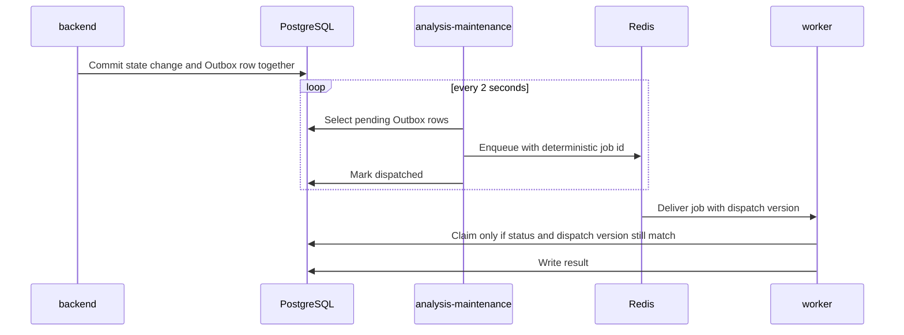

# Workers

Background execution for parsing, indexing, and coverage analysis. Work is never handed to Redis on trust: PostgreSQL decides what must run, and Redis only transports it.

## Processes

| Process | Entry point | Queue | Does |
|---|---|---|---|
| `analysis-worker` | `analysis_worker.execute_analysis_item` | `design-review` | Evaluates one frozen requirement per job |
| `indexing-worker` | `ingestion_worker.execute_document_ingestion`, `indexing_worker.execute_document_index` | `document-indexing` | Parses sources and builds the index, isolated from analysis |
| `analysis-maintenance` | `analysis_maintenance.run` | none | Publishes Outbox rows and repairs orphaned work |

Scale analysis with `docker compose up --scale analysis-worker=3`.

## How a job reaches a worker

Analysis and index jobs go through the Outbox. Parse jobs are enqueued directly by the API after the `parsing` state is committed; a parse job that is lost is caught by the maintenance deadline instead.

## Guarantees

| Mechanism | What it guarantees |
|---|---|
| **Transactional Outbox** | A state change and its Outbox row commit together. If the API exits right after commit, the work is still discoverable. |
| **Dispatch versions** | Each dispatch carries a version. A duplicate or stale delivery whose version no longer matches does nothing. |
| **Deterministic job IDs** | Republishing the same dispatch cannot create a second job. |
| **Leases and heartbeats** | An analysis worker claims an item with a lease and renews it from a separate heartbeat thread. If the lease is lost mid-evaluation, the attempt aborts instead of writing a result it no longer owns. |
| **Bounded retries** | An analysis item gets a fixed number of attempts with short delays. Outbox publishing retries with increasing delays. After the budget is spent, the item becomes a visible failure that can be retried manually. |
| **Single run-status rule** | A run's summary is always derived from its item states by one shared function (`domain/analysis.py`), used by the worker, the maintenance loop, and the read path. |

## The maintenance loop

Each cycle of `analysis-maintenance`:

1. fails parse jobs that have been `parsing` beyond the stale deadline, so they can be reparsed;
2. requeues analysis items whose lease expired, or fails them if attempts are exhausted;
3. re-dispatches queued items whose RQ job is missing or terminal;
4. backfills an Outbox row for any queued item without one;
5. publishes pending Outbox rows;
6. does the equivalent recovery for document indexing, up to its maximum attempts.

## Failure behaviour

| Failure | Result |
|---|---|
| Redis is down when a run is created | The run is committed and stays queued. Jobs are published when Redis returns. |
| A worker crashes mid-item | Its lease expires and the item is requeued with a new dispatch version. |
| The model provider errors | The attempt is recorded and retried within the item's budget, then the item fails visibly. |
| A stale job arrives after a requeue | Its dispatch version no longer matches, so it exits without writing. |
| A worker runs an incompatible task schema | The dispatch is rejected and recorded, not executed. |

Retry budgets, lease length, and deadlines are configurable; see the configuration table in [app/README.md](../README.md#configuration).
